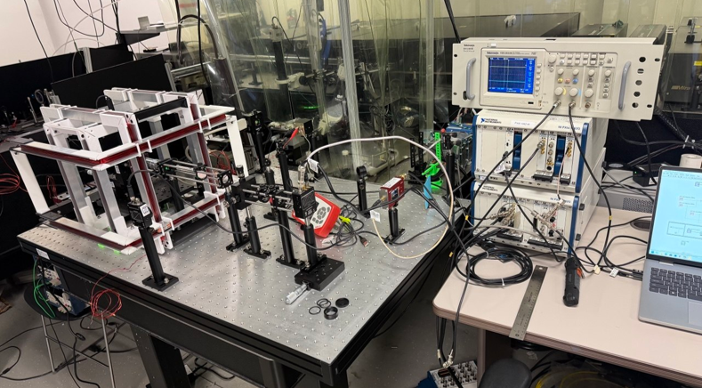

# Fieldable-NV-Center
Fieldable-NV-Center-Instrument

   
The beanch top demonstrater unit in the Fall of 2026. 

## Licensing and Citation

This work is licensed under a Creative Commons Attribution-ShareAlike 4.0 International License [cc-by-sa 4.0].

#### Bibtex

@Misc{ARTSLabSituMonitoringPowder,  
  author = {{ARTS-L}ab},  
  howpublished = {GitHub},   
  title  = {{LPBF}-Observer},  
  groups = {{ARTS-L}ab},  
  note = {Accessed: 20xx-xx-xx},  
  url    = {https://github.com/ARTS-Laboratory/LPBF-Observer},  
}  

QR code for repo.

