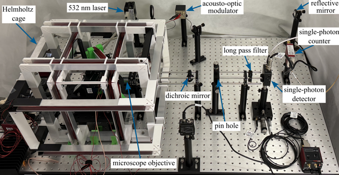
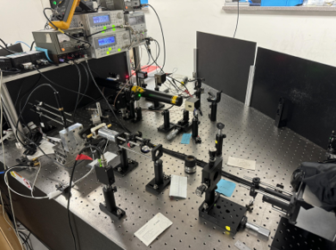

# System Development 
System development variations are named after historical scientists with strong connections to South Carolina.

## Russell
* NV-center ODMR setup designed for vector magnetometry and magnetic-field reconstruction.
* Named after Charles H. Townes, a South Carolina-born Nobel Prize-winning physicist and pioneer of laser technology

  
   
  <em>Russell NV-center vector magnetometry setup.</em>

media/Russell_2026_Fall.png

## Townes
* Benchtop NV-center ODMR setup designed for ESR/NMR experiments and pulsed measurements.
* Named after Edwin R. Russell, a Columbia-born nuclear chemist who contributed to the Manhattan Project

  
   
  <em>Townes NV-center ESR/NMR setup.</em>

